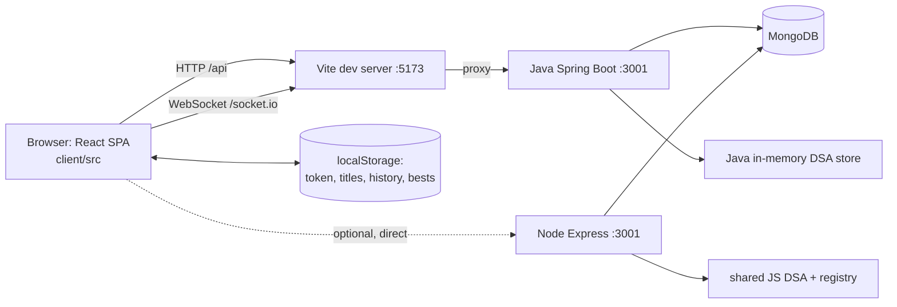
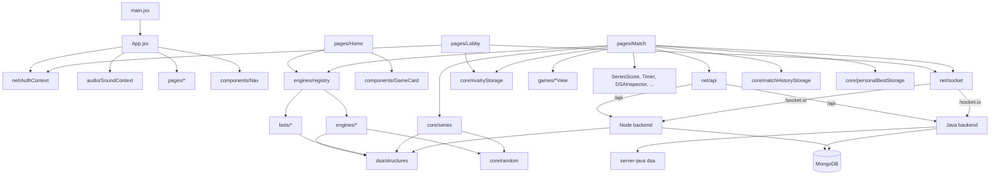

# Gameberry — Project Structure & Architecture Reference

Last verified against the source tree: 2026-11-26.

This document maps the real codebase: what exists, where it lives, how the pieces talk to each other, and where to change things. It is written for both new developers and AI coding agents.

---

## Instructions for AI Coding Agents

1. **Read this file first** before implementing a feature or changing existing behavior.
2. **Verify against the current source.** This document can go stale. If code and document disagree, the code wins; update this document in the same change.
3. **Find the existing owner of the behavior** before editing. Reuse `client/src/dsa/structures.js`, `client/src/engines/*`, `client/src/core/*`, the registry, and the existing services instead of duplicating them.
4. **Trace dependencies first.** For a change, check the engine, its view, the registry entry, `Match.jsx`, the storage modules, and the matching backend (Java and/or Node). The two backends are not interchangeable.
5. **Preserve the split:** pure game logic in `client/src/engines/`, React-only rendering in `client/src/games/`, bots in `client/src/bots/`, shared browser storage in `client/src/core/`, networking in `client/src/net/`.
6. **Update this document** whenever files are added, removed, renamed, or responsibilities move.
7. **Never assume a feature works because an endpoint or function exists.** Several server paths are wired but not used or not compatible with the client payloads (see [Known Issues & Inconsistencies](#known-issues--inconsistencies)).
8. **Do not add a second implementation of a data structure.** JS structures are in `client/src/dsa/structures.js`; Java structures are in `server-java/src/main/java/com/rivalryarena/dsa/`.
9. **Do not expose or print secrets.** Environment values are documented by name only.

---

## A. Project Overview

**Gameberry** is a browser-based 1v1/solo game arena whose games are built around classic data structures and algorithms (stacks, queues, hash maps, heaps, linked lists, backtracking, minimax, BFS). It supports:

- 4 versus games (Tic-Tac-Toe, Connect Four, Memory Card Flip, Minesweeper Race) versus bots, a local second player, or an online room.
- 3 solo games (2048, Sudoku 9×9, Speed Sudoku 4×4/6×6).
- Best-of-N series orchestration, 7-day rivalry titles, match history, personal bests, and a live "DSA Inspector".

**Stack**

| Layer | Technology |
|---|---|
| Frontend | React 18, React Router 6, Framer Motion, Vite 6, plain CSS |
| Client state | React component state + `localStorage` + Socket.IO |
| Active backend | Java 17, Spring Boot 3.2.5, Spring Web, Spring Data MongoDB, Spring WebSocket |
| Legacy/optional backend | Node.js + Express 4 + Socket.IO 4 + Mongoose 8 |
| Database | MongoDB (local by default), with in-memory fallbacks |
| Tests | Vitest 2 (JS), JUnit 5 (Java) |

**High-level architecture**



- In development, the SPA (`http://localhost:5173`) proxies `/api` and `/socket.io` to the Java server on `http://localhost:3001` (`vite.config.js`).
- Socket.IO client connects to `window.location.origin` with `transports: ['websocket']` (`client/src/net/socket.js`), so the Vite WebSocket proxy carries it to the Java server.
- Only one backend can bind `:3001` at a time. `npm run dev` starts the **Java** backend. `npm run dev:node`/`dev:server` starts the Express backend instead.
- The Vercel config builds the SPA only; it does not deploy either backend.

---

## B. Complete Folder Structure

Generated/dependency folders (`node_modules/`, `server-java/target/`, `dist/`, `.mvn/` caches) are intentionally omitted.

```text
GameBerry/
├─ package.json                 npm scripts, JS deps
├─ package-lock.json            npm lockfile
├─ vite.config.js               Vite root/proxy/build/test config
├─ vercel.json                  static deploy config
├─ README.md                    user-facing quick start + project description
├─ PROJECT_PLAN.md              original roadmap / academic plan (partly stale)
├─ run-all.bat                  Windows launcher: npm run dev
├─ run-java.bat                 Windows launcher: Java backend only
├─ .gitignore
│
├─ client/
│  ├─ index.html                SPA shell
│  └─ src/
│     ├─ main.jsx               React entry, router, providers
│     ├─ App.jsx                route table + global layout
│     ├─ index.css              global theme and utility classes
│     ├─ audio/                 sound provider + sound map
│     ├─ bots/                  bot move generators (one per game family)
│     ├─ components/            shared UI (nav, scoreboard, overlays, inspector)
│     ├─ core/                  storage, series state machine, RNG, clocks
│     ├─ dsa/                   custom JS data structures (+ tests)
│     ├─ engines/               pure game rules + registry (+ tests)
│     ├─ games/                 React boards/views per game
│     ├─ net/                   REST client, auth context, socket wrapper
│     └─ pages/                 route-level pages
│
├─ server/                      Node/Express backend (optional/legacy)
│  ├─ index.js                  Express + Socket.IO entry
│  ├─ config.js                 env config
│  ├─ middleware/auth.js        JWT middleware
│  ├─ models/                   Mongoose schemas
│  ├─ routes/                   REST routers
│  ├─ services/                 title, series, leaderboard logic
│  ├─ sockets/index.js          online room relay
│  └─ scripts/seed.js           demo data seeder
│
└─ server-java/                 Active Spring Boot backend
   ├─ pom.xml
   ├─ mvnw.cmd                  broken wrapper (missing jar); use system mvn
   └─ src/
      ├─ main/java/com/rivalryarena/
      │  ├─ RivalryArenaApplication.java
      │  ├─ config/             CORS, JWT utility
      │  ├─ controller/         REST controllers
      │  ├─ service/            storage/title/series services
      │  ├─ model/              Mongo documents + request shapes
      │  ├─ repository/         Spring Data repositories
      │  ├─ dsa/                custom Java data structures
      │  └─ websocket/          room registry + Socket.IO-ish relay
      ├─ main/resources/application.properties
      └─ test/java/com/rivalryarena/dsa/DsaStructuresTest.java
```

**Folder responsibilities**

| Folder | Responsibility |
|---|---|
| `client/src/pages` | Route screens: landing, lobby/config, match orchestrator, profile |
| `client/src/games` | Rendering + input for each board; no game rules |
| `client/src/engines` | Deterministic game rules and status/inspection API |
| `client/src/bots` | Bot move selection, consumed by the match orchestrator |
| `client/src/core` | Cross-game logic: series, RNG, clocks, localStorage persistence |
| `client/src/dsa` | The custom structures the project demonstrates |
| `client/src/components` | Reusable visual pieces and overlays |
| `client/src/net` | API/token handling, auth context, socket client |
| `client/src/audio` | Sound mapping and playback (with synth fallback) |
| `server/` | Alternate Express implementation of the same domain |
| `server-java/` | The backend actually started by `npm run dev` |

---

## C. File-by-File Explanation

### Root files

**`package.json`** — npm manifest. Scripts: `dev` (Vite + Java concurrently), `dev:client`, `dev:java` (`mvn spring-boot:run`), `dev:server`/`dev:node` (Express with `--watch`), `build` (`vite build`), `start` (Node server), `seed` (Node seeder), `test`/`test:watch` (Vitest). Declares React, router, framer-motion, Express, Mongoose, Socket.IO, JWT, bcrypt. **Edit when** adding dependencies or changing how the app is started/built.

**`vite.config.js`** — Sets `root: 'client'`, React plugin, dev port 5173, proxies `/api` and `/socket.io` (WS) to `:3001`, build output `../dist`, Vitest config (`environment: node`, includes `client/**/*.test.js` and `server/**/*.test.js`). **Edit when** changing ports, proxy targets, build output, or test discovery.

**`vercel.json`** — Build command `npm run build`, output `dist`, SPA rewrite `/(.*) → /`. It deploys the frontend only. **Edit when** deployment routing changes.

**`README.md`** — Human quick start, design principles, DSA matrix, title rules, demo script. Partly aspirational/stale relative to code: it still mentions Snake and "8 games". **Edit when** user-facing behavior or setup changes.

**`PROJECT_PLAN.md`** — Original architecture/roadmap, including the Snake design and DSA matrix. It is planning material, not a description of the current tree. **Edit only** when revisiting the roadmap.

**`run-all.bat`** — Windows helper that optionally sets `JAVA_HOME` and calls `npm run dev`. **Edit when** the Windows launch flow changes.

**`run-java.bat`** — Windows helper that runs `mvn spring-boot:run` in `server-java/`. **Edit when** Java startup changes.

**`.gitignore`** — Ignores `node_modules/`, `dist/`, env files, logs, IDE files, Maven `target/`, and compiled classes. **Edit when** new generated artifacts appear.

**`package-lock.json`** — Generated npm lockfile. Do not hand-edit.

---

### Client root and styling

**`client/index.html`** — Vite HTML entry: `#root` mount point, emoji favicon, title/meta tags, loads `/src/main.jsx`. **Edit** for document metadata or external assets.

**`client/src/main.jsx`** — Mounts `<App />` inside `React.StrictMode` and `BrowserRouter`; imports global CSS. **Edit** only for global providers/router setup.

**`client/src/App.jsx`** — Wraps the app in `AuthProvider` and `SoundProvider`, renders `Nav` and the route table:
`/` and `/games` → Home; `/play/:gameId` and `/play` → Match; `/arena` and `/lobby` → Lobby; `/match` → Match; `/profile` and `/profile/:userId` → Profile. **Edit when** adding pages/routes.

**`client/src/index.css`** — Global warm-white/orange theme: CSS variables (`--p1-blue`, `--warm-orange`, etc.), fonts, `.btn`, `.card`, badges, grids, responsive rules. **Edit when** changing the shared visual system; per-screen styling is mostly inline in JSX.

---

### Audio (`client/src/audio`)

**`SoundContext.jsx`** — React context providing `muted`, `volume`, `toggleMute`, `setVolume`, `playSound(id)`. Muted by default (`ra_muted` in localStorage); lazily creates an `AudioContext`; attempts `/sounds/<file>.mp3` then falls back to an oscillator. **Used by** `App.jsx`, `Nav`, `Countdown321`, `Timer`, `Match`. **Edit** for audio behavior or persistence keys.

**`soundMap.js`** — Maps sound ids (`win_nikal`, `loss_khatam`, `combo_hype`, `slide`, `click`, `tick`, etc.) to file names and synth fallback parameters. Note: there is no `client/public/sounds/` directory, so real MP3s are absent and the oscillator path is what runs. **Edit** when adding sounds.

---

### Bots (`client/src/bots`)

All bots export `getMove(state, difficulty)` and never mutate React state. `Match.jsx` calls them only for turn-based games against a bot (Tic-Tac-Toe, Connect Four, Memory); the others are registered but not driven by the current match loop.

- **`ticTacToeBot.js`** — Easy: random; Medium: win/block heuristic; Hard: minimax. Depends on board shape from `ticTacToe.js`. **Edit** for Tic-Tac-Toe AI strength.
- **`connectFourBot.js`** — Alpha-beta search (Easy depth 2, Medium 4, Hard 6) using cloned `Stack` columns and a heuristic evaluator. **Edit** for Connect Four AI.
- **`memoryBot.js`** — Simulated memory via an LRU cache (HashMap + DoublyLinkedList); capacity 4/8/16 by difficulty. **Edit** for Memory AI.
- **`minesweeperBot.js`** — Rule-based solver; uses a work `Queue` and safe/mine deductions. Not called by the current match loop (Minesweeper is a race, not turn-based versus). **Edit** for solver logic.
- **`sudokuBot.js`** — "Paced ghost" that fills cells from `state.solution`; `PACE_MS = { easy: 3000, medium: 1500, hard: 800 }`. Registered for both Sudoku engines; solo play does not invoke it. **Edit** for paced-solver behavior.
- **`game2048Bot.js`** — Greedy/expectimax move chooser with grid heuristics. Registered for solo 2048; not invoked by `Match.jsx`. **Edit** for 2048 AI.

---

### Shared components (`client/src/components`)

- **`Nav.jsx`** — Sticky top bar: brand, Games/Arena links, P1/P2 pass-and-play toggle (`activePlayer`), mute toggle, profile link. Depends on `AuthContext`, `SoundContext`. **Edit when** navigation or global controls change.
- **`GameCard.jsx`** — Card for a registry entry; solo games navigate to `/play/:id` with solo state, versus games navigate to `/lobby` with `selectedGame`. **Edit when** game entry flow changes.
- **`SeriesScore.jsx`** — Scoreboard with per-round win pips; solo variant. Props: `series`, `p1Name`, `p2Name`, `isSolo`. **Edit when** score presentation changes.
- **`Countdown321.jsx`** — 3-2-1-GO overlay, plays sounds, calls `onComplete`. Uses framer-motion. **Edit when** pre-round flow changes.
- **`Timer.jsx`** — `requestAnimationFrame` display for a stopwatch or countdown; critical countdown ticks. Props: `stopwatch`, `countdown`, `isRunning`. **Edit when** timing display changes.
- **`CrushedStamp.jsx`** — "CRUSHED!" stamp + confetti overlay with 3.5 s auto-dismiss; props `winnerName`, `loserName`, `onDismiss`. **Edit when** victory animation changes.
- **`LoserFlash.jsx`** — Red/grayscale flash on defeat; calls `onComplete`. **Edit when** defeat animation changes.
- **`Badge.jsx`** — Expandable rivalry-title card with 7-day countdown, dates, opponent name, and a rematch action that navigates to the lobby. Props: `title`, `type`, `onRematch`. Used by `Profile`. **Edit when** title presentation/rules change.
- **`HandoverScreen.jsx`** — Pass-and-play "hand the device over" shield. **Currently not imported anywhere**; retained for local multiplayer UX.
- **`DSAInspector.jsx`** — Collapsible panel showing `engine.inspect(state)` metrics plus a hand-written guide per game (`GAME_DSA_GUIDE`). Has guides keyed `tic-tac-toe`, `connect-four`, `memory-cards`, `minesweeper`, `2048`, `speed-sudoku`, `sudoku`; the Memory registry id is `memory`, so its guide key does not match (see issues). Used by `Match`. **Edit when** adding metrics/explanations or a game.

---

### Core (`client/src/core`)

- **`random.js`** — Mulberry32 seeded PRNG (`createRandom(seed)` with `next`, `int`, `getState`, `setState`) and `shuffle` (Fisher–Yates). Used by every engine and `series.js`. **Edit** only for RNG changes; seeded determinism depends on it.
- **`series.js`** — Best-of-N state machine. `createSeries({ games, format, seed, players, titleMode })` builds a `Queue` of games; `nextGame`, `recordRound` (draw replays up to twice, then void + extra round; Best-of-2 sudden death; majority completion), `seriesWinner`, `seriesSummary`. Used by `Match.jsx` and tests. **Edit** for match format/draw rules.
- **`stopwatch.js`** — `createStopwatch()` (timestamp-based, `start/pause/reset/elapsed`), `createCountdown(durationMs)` (`remaining`, `expired`, `elapsed`), and `formatTime(ms)`. Used by `Match`, `Timer`. **Edit** for timing semantics.
- **`engineContract.js`** — Documents the engine contract (`create`, `apply`, `status`, `inspect`) and exports `validateEngine(engine)`. Used by tests. **Edit** when the engine API changes.
- **`eventBus.js`** — Tiny pub/sub (`createEventBus`, singleton `globalBus`). Exported but not used by current pages/engines. **Edit** or remove only with care.
- **`matchHistoryStorage.js`** — localStorage key `ra_match_history_v1`: `getMatchHistory`, `saveMatchRecord` (newest first, max 50), `clearMatchHistory`. Called by `Match` and `Profile`; tested by `titleAndHistory.test.js`. **Edit** for history fields/retention.
- **`rivalryStorage.js`** — localStorage key `ra_rivalry_titles_v1`: 7-day human-vs-human titles; `getActiveRivalries` (filters expired + bot names), `saveRivalryResult` (rejects bots, replaces reverse title), `clearRivalry`. Called by `Lobby`, `Profile`, `Match`; tested. **Edit** for local title rules.
- **`personalBestStorage.js`** — localStorage key `ra_personal_bests_v1`: `getPersonalBests`, `recordGameResult` (score/time/streak metrics per game), `getAllConfiguredGames`, plus internal `GAME_METRIC_CONFIG`. Note the Memory key is `memory-cards` while the registry id is `memory`. Used by `Match`, `Profile`; tested. **Edit** for best-score logic.

---

### DSA (`client/src/dsa`)

**`structures.js`** — The canonical JavaScript implementations demonstrated by the project:
- `Stack` (`push`, `pop`, `peek`, `clear`, `size`, `toArray`)
- `Queue` (ring-ish head index, `enqueue`, `dequeue`, `size`, `peakSize`, compaction)
- `DoublyLinkedList` (`pushFront`, `pushBack`, `remove`, `popBack`, `values`, `size`)
- `HashMap` (FNV-1a hash, separate chaining, `set/get/has/delete`, `loadFactor`, resize at 0.75)
- `PriorityQueue` (binary heap, comparator, optional `limit` for top-k, `push/pop/peek/size`)
Used by engines, `core/series.js`, and imported directly by the Node server (`server/services/*`, `server/sockets`). **Edit** only with matching test updates.

**`__tests__/structures.test.js`** — 28 Vitest tests covering Stack, Queue, DoublyLinkedList, HashMap (including resize), and PriorityQueue (min/max, limit, comparator). **Edit** with any structure change.

---

### Engines (`client/src/engines`)

All engines follow `create(seed, options) → state`, `apply(state, action) → { state, events }`, `status(state)`, `inspect(state)`. `apply` returns a new top-level object but mutates nested state in place; treat state as owned by the engine.

- **`ticTacToe.js`** — 3×3 board (2D array), `undoStack`/`redoStack` (`Stack`); actions `move {row,col}`, `undo`, `redo`; status `phase/winner/currentPlayer/moveCount`; detects wins/draws and "clutch block" combo events. **Edit** for Tic-Tac-Toe rules.
- **`connectFour.js`** — 6×7 grid projected from 7 `Stack` columns; actions `drop {col}` and `hover {col}`; 4-direction raycast win detection; status + inspect column sizes/grid/win cells. **Edit** for Connect Four rules.
- **`memory.js`** — 4×4 or 6×6 deck (`options.size`), Fisher–Yates shuffle, `HashMap` card states and per-player streaks; actions `flip {index}` and `resolveMismatch`; match grants another turn; game ends when all pairs matched. **Edit** for Memory rules.
- **`minesweeper.js`** — Seeded board (`options.rows`, `cols`, `mines`, `variant`), safe opening pre-revealed via BFS `Queue`; actions `reveal {row,col}` and `flag {row,col}`; status includes `progress`; inspect includes `peakBFSQueueSize`. **Edit** for Minesweeper rules.
- **`sudoku.js`** — 9×9 backtracking generator with uniqueness check (`options.difficulty`), row/column/box `HashMap`s, conflict set; action `move {row,col,val}`; win when full and conflict-free. **Edit** for 9×9 Sudoku.
- **`speedSudoku.js`** — 4×4/6×6 generator (`options.size`, `timeLimitMs`), same hash-conflict approach; actions `move` and `timeout` (phase `dnf`); status includes timer fields. **Edit** for timed Sudoku.
- **`game2048.js`** — 4×4 grid of tile objects seeded RNG; actions `move {dir}` (`up/down/left/right`) and `undo` (max 3 snapshots including RNG state); merge/score logic; win at `options.targetTile || 512`, loss when no moves. **Edit** for 2048 rules.
- **`registry.js`** — `GAME_REGISTRY` (the 7 real games with `id`, `name`, `category`, `icon`, `format: 'turn-based'|'race'|'solo'`, `modeType: 'versus'|'solo'`, `engine`, `bot`) and helpers `getGame`, `getVersusGames`, `getSoloGames`. This is the single source of truth for available games. **Edit when** adding/removing a game.
- **`__tests__/engines.test.js`** — For every registry entry: contract validation, deterministic `create`, inspect metadata. Description says "All 8 Engines" but iterates the current registry (7).
- **`__tests__/gameplay.test.js`** — Tic-Tac-Toe and Connect Four apply/bot moves, a Best-of-1 series, and Memory auto-resolution/bot safety.
- **`__tests__/titleAndHistory.test.js`** — localStorage-mocked tests for 7-day titles (bots rejected), human title saving, match history for all modes, and personal bests.

---

### Game views (`client/src/games`)

These are presentational/input components receiving `state`, `onAction`, and `disabled`; they must not contain rules.

- **`TicTacToeView.jsx`** — 3×3 board, winning-line highlight, X/O colors, move buttons.
- **`ConnectFourView.jsx`** — 6×7 board, hover ghost per column, drop animation and win cells.
- **`MemoryView.jsx`** — Card grid, flip animation, auto-dispatches `resolveMismatch` after 900 ms, score/streak display.
- **`MinesweeperView.jsx`** — Grid with reveal/flag mode toggle, touch/mobile support, neighbor colors, counters.
- **`SudokuView.jsx`** — 9×9 grid, keyboard navigation and number entry, conflict highlighting.
- **`SpeedSudokuView.jsx`** — 4×4/6×6 grid with 2×2 or 2×3 boxes, number pad and keyboard input.
- **`Game2048View.jsx`** — Animated tiles, score, undo button, arrow keys and touch swipes.

**Edit a game view** for presentation/input changes only; rules go in the engine.

---

### Networking (`client/src/net`)

- **`api.js`** — Fetch wrapper. Base URL `import.meta.env.VITE_API_URL || '/api'`; stores JWT in `localStorage` key `ra_token`; attaches `Authorization: Bearer`; parses JSON/text and throws on non-2xx. Exports `setToken`, `getToken`, and `api.get/post/put/delete`. Used by `AuthContext`, `Profile`, `Match`. **Edit** for API base/auth handling.
- **`AuthContext.jsx`** — `AuthProvider`/`useAuth`. On mount: validates stored token via `/auth/me`, otherwise creates/reuses a device token (`ra_guest_device_token`) and calls `/auth/guest`; on total failure creates an offline mock user. Provides `user`, `loading`, `login`, `register`, `logout`, `activePlayer`, `setActivePlayer`. **Edit** for auth UX/flow.
- **`socket.js`** — Creates the Socket.IO client at `window.location.origin` (or `VITE_WS_URL`), websocket-only, auto-reconnect. Helpers: `syncUser`, `createRoom`, `joinRoom`, `leaveRoom`, `sendMove`, `sendProgress`, `sendResult`, `requestRematch`, `acceptRematch`. Used by `Lobby` and `Match`; `sendProgress`/`sendResult` are currently never called. **Edit** when socket events change.

---

### Pages (`client/src/pages`)

- **`Home.jsx`** — Landing page: hero, buttons, versus/solo game grids from the registry, DSA pitch card. Uses `GameCard`. **Edit** for landing content/structure.
- **`Lobby.jsx`** — Configures a match: opponent type (`bot`, `local`, `online`), bot difficulty, series format (1/2/3/5), title mode, game selection; shows active grudges/titles and rooms. Creates/joins rooms via sockets, listens for `room-updated`, `match-countdown-start`, `room-closed`, and navigates to `/play` with the full match config. Local/bot matches navigate immediately. **Edit** for match setup, room UX, or online connection flow.
- **`Match.jsx`** — The orchestrator (largest client file): creates the series, seeds rounds, mounts engine + view by `currentGameId`, handles bot turns, remote moves, timers, round/series completion, rematch, overlays, DSA Inspector, localStorage records, and `POST /api/matches`. **Edit for almost any gameplay-flow change**; keep rules in engines and render in views.
- **`Profile.jsx`** — Shows active titles (`Badge`), match history (server + local merge), personal bests, and login/register modal. Loads `/titles/:userId` and `/matches?userId=` in parallel, falling back to local data. **Edit** for profile UI/data merging.

---

### Node backend (`server/`)

The Express backend mirrors the Java API but is not started by `npm run dev`.

- **`config.js`** — Reads `PORT`, `MONGO_URI`, `JWT_SECRET`, `CLIENT_ORIGIN`, `TITLE_DURATION_DAYS`, `TITLE_CLEANUP_DAYS` with development defaults. **Edit** when adding env-backed config.
- **`index.js`** — Express entry: CORS, JSON body parsing, mounts `/api/auth`, `/api/users`, `/api/matches`, `/api/titles`, `/api/leaderboards`, `/api/health`, creates Socket.IO, connects to Mongo with 3 s timeout and continues offline, then listens (default 3001). **Edit** when adding routes/middleware or changing startup.
- **`middleware/auth.js`** — `auth` (required Bearer JWT, sets `req.user`) and `optionalAuth`. **Edit** for token handling.
- **`models/User.js`** — Mongoose user: `username` (unique), `passwordHash`, `guestToken`, `isBot`, `botDifficulty`, `wins`, `losses`, `fastestTimes` (Map), `createdAt`; static `findOrCreateGuest`. **Edit** for user schema.
- **`models/MatchRecord.js`** — One document per series: `players[{userId,username}]`, `mode` (`title|friendly`), `format` (2/3/5), `games[]` (game, variant, seed, winner index, times, scores), `finalScore`, `winner`, `titleMode`, `startedAt`, `completedAt`. **Edit** for series persistence shape.
- **`models/RivalryTitle.js`** — Title document: `winner`/`loser` (ObjectId refs), `series`, `awardedAt`, `expiresAt`, `status` (`active|reclaimed|expired`), `reclaimedAt`; indexes on `(winner, loser)` and `expiresAt`. **Edit** for title schema.
- **`models/Leaderboard.js`** — `board`, `userId`, `username`, `bestTime`; unique `(board, userId)`. **Edit** for leaderboard schema.
- **`routes/auth.js`** — `POST /guest`, `POST /register`, `POST /login`, `GET /me` (auth). Guest/register/login behaviors differ from Java (see section F). **Edit** for Node auth.
- **`routes/users.js`** — `GET /:id` profile and `GET /:id/titles`, both 503 when Mongo is down. **Edit** for Node profile endpoints.
- **`routes/matches.js`** — `POST /` (auth) validates `players` length 2 + `winner`, calls `completeSeries`; `GET /?userId=` returns recent matches (empty offline). **Edit** for Node match persistence.
- **`routes/titles.js`** — `GET /active`, `GET /:userId`, `POST /cleanup` (expire/delete old titles). **Edit** for Node title endpoints.
- **`routes/leaderboards.js`** — `POST /` (auth) body `{board,time}`; `GET /:board` top 10. Note the Java API uses `POST /:board` instead. **Edit** for leaderboard behavior.
- **`services/titleRules.js`** — Pure functions: `decideTitleOutcome` (renew/reclaim/award), `isExpired`, `shouldCleanup`. Testable without DB. **Edit** for title rules.
- **`services/seriesService.js`** — In-memory `titleCache` (`HashMap`), `rebuildTitleCache`, and `completeSeries` (persists match, increments wins/losses, applies title actions). **Edit** for series completion logic.
- **`services/leaderboardService.js`** — `submitTime` (upsert better time) and `getTopTimes` (top-k via JS `PriorityQueue`), both Mongo-dependent/empty offline. **Edit** for leaderboard scoring.
- **`sockets/index.js`** — Socket.IO relay: in-memory `rooms`/`presence`/`soundboardCooldowns` (`HashMap`), room codes, `set-user`, `create-room`, `join-room`, `leave-room`, `move`, `progress`, `result`, `rematch-request`, `rematch-accept`, disconnect handling. **Edit** for Node online play.
- **`scripts/seed.js`** — Clears and seeds demo bots (`RoboRival Easy/Medium/Hard`), two humans, a sample match/title, and leaderboard times. Requires MongoDB. **Edit** for demo data.

---

### Java backend (`server-java/src/main/java/com/rivalryarena`)

- **`RivalryArenaApplication.java`** — `@SpringBootApplication` entry. On startup pings Mongo via `MongoTemplate`, toggles `DataStoreService.mongoConnected`, prints banners. **Edit** for startup/bootstrap behavior.
- **`config/CorsConfig.java`** — Global CORS allowing all origins/methods/headers.
- **`config/JwtUtil.java`** — Hand-rolled HS256 JWT: `generateToken` (30 days), `validateToken`, `getUserIdFromToken`, `getUsernameFromToken`. Secret is hardcoded in this file (documented as a risk, not a value). **Edit** for token claims/expiry, and move the secret to config before production.
- **`controller/AuthController.java`** — `/api/auth`: `POST /guest`, `POST /register`, `POST /login`, `GET /me`. BCrypt via `BCryptPasswordEncoder`; guest ids `guest_<8>`; users `user_<8>`; returns `{token,user}` (and `deviceToken` for guests). **Edit** for auth behavior.
- **`controller/HealthController.java`** — `GET /api/health` → `{status, serverTime, mongoConnected, backend}`.
- **`controller/LeaderboardController.java`** — `GET /api/leaderboards/{board}` (top 10) and `POST /api/leaderboards/{board}` body `{userId, username, bestTime}`.
- **`controller/MatchController.java`** — `POST /api/matches` accepts a `MatchRecord` JSON and calls `SeriesService`; `GET /api/matches?userId=` returns that user's matches (requires `userId`). **Edit** when changing the accepted match payload.
- **`controller/TitleController.java`** — `GET /api/titles/{userId}` returns active/relevant titles from the store.
- **`controller/UserController.java`** — `GET /api/users/{id}` → `{user, activeTitles}`.
- **`controller/SocketIoPollingController.java`** — Responds to `/socket.io` GET/POST polling handshakes with a fixed Engine.IO v4 open packet. It is a handshake shim, not a full long-polling implementation; the client uses websocket transport. **Edit/remove** only when reworking the socket layer.
- **`service/DataStoreService.java`** — Dual storage. Uses Mongo repositories when `mongoConnected`, otherwise Java DSA-backed memory: `CustomHashMap` for users/titles, `DoublyLinkedList` for matches, `MinHeapPriorityQueue` per leaderboard. Also expires titles lazily on read and caps leaderboards to 10. **Edit** for persistence/fallback behavior.
- **`service/SeriesService.java`** — `recordMatchResult`: increments wins/losses, applies title renew/reclaim/mint when `titleMode` is true, saves the match. **Depends on** the incoming `winnerId`/`loserId` fields. **Edit** for server-side series/title rules.
- **`service/TitleRulesService.java`** — Title constants (`TITLE_DURATION_MS = 7 days`), `getPairKey`, `isBotUser` (rejects names containing "bot"/"roborival"), `mintTitle` (creates active 7-day title, returns null for bots). **Edit** for title rules.
- **`model/User.java`** — Mongo `users` document: `id`, `username`, `passwordHash`, `isGuest`, `deviceToken`, `wins`, `losses`, `createdAt`. Note it differs from the Node user schema.
- **`model/MatchRecord.java`** — Mongo `match_records`: `id`, `seriesId`, `format`, `titleMode`, `players[{id,username}]`, `winnerId`, `winnerName`, `loserId`, `loserName`, `seriesScore`, `rounds[{roundNumber,gameId,winnerId,isDraw,durationMs}]`, `titleAwarded`, `createdAt`. Differs from the Node schema.
- **`model/RivalryTitle.java`** — Mongo `rivalry_titles`: ids/names of winner and loser, `pairKey`, game info, scores, `seriesId`, `status`, `createdAt`, `expiresAt`, `reclaimedAt`.
- **`model/LeaderboardEntry.java`** — Mongo `leaderboards`: `id`, `board`, `userId`, `username`, `bestTime`, `achievedAt`.
- **`repository/UserRepository.java`** — `findByUsername`, `findByDeviceToken`.
- **`repository/MatchRecordRepository.java`** — `findByWinnerIdOrLoserIdOrderByCreatedAtDesc`.
- **`repository/RivalryTitleRepository.java`** — by winner/loser + status, and by `pairKey` + status.
- **`repository/LeaderboardRepository.java`** — by board ordered by best time; by board+userId.
- **`dsa/CustomHashMap.java`** — Separate-chaining map with resize; `put/get/containsKey/remove/size/isEmpty/getLoadFactor/getBucketCount/entries/keySet/values/clear`.
- **`dsa/CustomQueue.java`** — Linked-node FIFO: `enqueue/dequeue/peek/size/isEmpty/clear`.
- **`dsa/CustomStack.java`** — Linked-node LIFO: `push/pop/peek/size/isEmpty/clear`.
- **`dsa/DoublyLinkedList.java`** — `addFirst/addLast/removeFirst/removeLast/removeNode/peekFirst/peekLast/size/isEmpty/clear/toList` + `Iterable`. Used for in-memory match history.
- **`dsa/MinHeapPriorityQueue.java`** — Comparator-based binary heap: `insert/peek/extractMin/size/isEmpty/getSortedList/getAt`. Used for leaderboards.
- **`websocket/WebSocketConfig.java`** — Registers `GameSocketHandler` at `/socket.io/`, `/socket.io`, `/ws` with any origin.
- **`websocket/GameSocketHandler.java`** — Raw Spring WebSocket handler that emulates Socket.IO framing enough for the client: sends Engine.IO/Socket.IO handshake when `EIO=` is present, answers `"2"` with `"3"`, parses `42[...]` and plain JSON, and handles `set-user`, `create-room`, `join-room`, `move`, `progress`, `rematch-request`, `rematch-accept`, `leave-room`, disconnect. Emits both `42[...]` frames and a plain JSON copy (non-standard). **Does not support Socket.IO acknowledgements**, so room callbacks never fire. **Edit** for online event behavior.
- **`websocket/Room.java`** — Room model: code, host/guest session + user ids/names, `seriesConfig`, status, `toMap()`. No seed field.
- **`websocket/RoomRegistry.java`** — `CustomHashMap` of rooms; `generateUniqueCode` (4 chars from an unambiguous alphabet), `createRoom`, `getRoom`, `removeRoom`, `findRoomBySessionId`.
- **`src/main/resources/application.properties`** — `server.port=3001`; Mongo URI with 2 s selection/connect timeouts; `auto-index-creation=false`; log levels. **Edit** for ports/DB/logging.
- **`src/test/java/com/rivalryarena/dsa/DsaStructuresTest.java`** — JUnit 5 tests for `DoublyLinkedList`, `MinHeapPriorityQueue`, `CustomHashMap`, `CustomStack`, `CustomQueue`. Run with Maven.

---

## D. Frontend Architecture

**Entry and routing**

`main.jsx → App.jsx` provides auth/sound contexts and routes. `Nav` is always visible. Pages are thin; `Match.jsx` is the gameplay engine.

**State management**

- No Redux/Zustand. State is React `useState`/`useRef`.
- `AuthContext` holds the user and pass-and-play player index.
- `SoundContext` holds mute/volume.
- Persistence is browser-first: `matchHistoryStorage`, `rivalryStorage`, `personalBestStorage`, `api.js` token, `SoundContext` settings, `AuthContext` device token.
- The series state is created in `Match.jsx` with `createSeries`, updated with `recordRound`, and stored in React state.

**Game flow**

1. `Home` renders registry cards.
2. `GameCard` routes solo games straight to `/play/:id` and versus games to `/lobby`.
3. `Lobby` builds a config `{ format, titleMode, games, players, isOnline, roomCode?, seed? }` and navigates to `/play` (online after a socket countdown).
4. `Match` creates the series and the first engine state, shows `Countdown321`, then renders the matching view and passes `handleEngineAction`.
5. Engine events drive sounds; `status()` ends the round; `recordRound` advances the series; the end modal offers rematch or lobby.
6. Completion writes localStorage history/titles/bests and attempts `POST /api/matches`.

**API communication**

All REST calls go through `client/src/net/api.js`. Actual calls in the current client:

| Caller | Call |
|---|---|
| `AuthContext` | `GET /auth/me`, `POST /auth/guest`, `POST /auth/login`, `POST /auth/register` |
| `Profile` | `GET /titles/:userId`, `GET /matches?userId=` |
| `Match` | `POST /matches` |

Sockets are used only in `Lobby` and `Match`.

**Styling/assets**

Global theme in `client/src/index.css`; most component styling is inline. Icons are emoji. No image assets. Sound files are referenced but absent (`client/public/` does not exist), so the synth fallback plays.

---

## E. Backend Architecture

### Which backend is active?

- `npm run dev` → Vite + **Java Spring Boot** (`server-java`) on port 3001.
- `npm run dev:node` / `dev:server` / `npm start` → **Node/Express** (`server`) on port 3001.
- `server/` is therefore a legacy/alternative implementation. It is still functional code and shares the client DSA/registry modules, but the running application uses Java.
- They cannot run simultaneously on the same port. They also have different document shapes/collection names and different auth details.

### Java backend (active)

- REST controllers under `/api/*` (see section H).
- `DataStoreService` chooses Mongo or the in-memory Java DSA store at request time based on `mongoConnected`.
- Auth: BCrypt hashes, custom HS256 JWT (`JwtUtil`), 30-day expiry.
- WebSocket: Spring `TextWebSocketHandler` with manual Engine.IO/Socket.IO framing, room registry in `CustomHashMap`.
- Startup: pings Mongo; on failure logs and serves from memory.

### Node backend (optional)

- Express routers under `/api/*`, Mongoose models, JWT via `jsonwebtoken`, Socket.IO server.
- Shares custom JS structures (`HashMap`, `PriorityQueue`) and `GAME_REGISTRY` with the client.
- Falls back to "offline" behavior: health reports `mongoConnected`, auth returns ephemeral guests, many reads return empty lists.
- Includes the only seeding script (`npm run seed`).

---

## F. Database and Authentication

**Database**

- MongoDB. Node default URI: `mongodb://localhost:27017/rivalry-arena` (`MONGO_URI` override).
- Java URI in `application.properties` with `serverSelectionTimeoutMS=2000&connectTimeoutMS=2000`.
- Collections differ by backend:
  - Java `@Document`: `users`, `match_records`, `rivalry_titles`, `leaderboards`.
  - Node Mongoose defaults: `users`, `matchrecords`, `rivalrytitles`, `leaderboards`.
- When Mongo is unavailable, the app still runs:
  - Java: in-memory `CustomHashMap`/`DoublyLinkedList`/`MinHeapPriorityQueue` store; data is lost on restart.
  - Node: ephemeral guests and empty reads; writes that require Mongo are skipped.

**Authentication flow**

1. On first load, the client checks `ra_token`; if present it calls `/auth/me`.
2. Otherwise it creates/reuses `ra_guest_device_token` and calls `POST /auth/guest`.
3. Registered users can log in/register from the Profile modal; the returned JWT is stored in `ra_token`.
4. The client attaches `Authorization: Bearer <token>` to all API calls.
5. Logout clears `ra_token` and sets a local guest user object; it does not call the server.

**Guest flow differences**

- Java: ignores the client-supplied `deviceToken`; generates a new guest id and device token on every call. Persistence depends on the stored JWT, not the device token.
- Node: ignores the client-supplied `guestToken` too; generates a fresh UUID and calls `findOrCreateGuest`, so a new user is created per call.

**Registered users**

- Java: username + password (min 3 chars); BCrypt; returns user object including `passwordHash` and `deviceToken` fields.
- Node: username ≥ 2, password ≥ 4; bcrypt cost 10; requires Mongo (503 offline); returns a sanitized subset.

**Authorization**

- Only `GET /api/auth/me` (Java/Node) and a few Node routes (`POST /matches`, `POST /leaderboards`) validate JWTs. Most Java reads/writes (`/api/matches`, `/api/leaderboards`, `/api/users`, `/api/titles`) are unauthenticated.
- Java stores the JWT secret in `JwtUtil.java`; Node uses `JWT_SECRET`.
- Environment variable names in use: `PORT`, `MONGO_URI`, `JWT_SECRET`, `CLIENT_ORIGIN`, `TITLE_DURATION_DAYS`, `TITLE_CLEANUP_DAYS`, plus Vite `VITE_API_URL`, `VITE_WS_URL`. No `.env` file is committed.

**Title persistence**

- Primary working path today is **localStorage** (`rivalryStorage.js`), used by Lobby/Profile/UI.
- Server-side titles require a valid title-mode match record. On the Java backend the client payload does not populate the fields Java reads, so server titles are not minted from normal gameplay (see issues).
- Node title rules: one active title per ordered pair; renew on repeat win; reclaim + award on reversal; bots excluded by client-side name checks (Node `completeSeries` has no explicit bot guard).

---

## G. Games and DSA Implementations

**Registry is the source of truth:** `client/src/engines/registry.js`. Currently 7 games. There is **no Snake implementation** in the tree, although `README.md`/`PROJECT_PLAN.md` describe one.

| Game | ID | Engine | View | Bot | Mode |
|---|---|---|---|---|---|
| Tic-Tac-Toe | `tic-tac-toe` | `ticTacToe.js` | `TicTacToeView.jsx` | `ticTacToeBot.js` | 1v1 turn-based |
| Connect Four | `connect-four` | `connectFour.js` | `ConnectFourView.jsx` | `connectFourBot.js` | 1v1 turn-based |
| Memory Card Flip | `memory` | `memory.js` | `MemoryView.jsx` | `memoryBot.js` | 1v1 turn-based |
| Minesweeper Race | `minesweeper` | `minesweeper.js` | `MinesweeperView.jsx` | `minesweeperBot.js` | 1v1 race (or solo config) |
| 2048 | `2048` | `game2048.js` | `Game2048View.jsx` | `game2048Bot.js` | solo |
| Sudoku 9×9 | `sudoku` | `sudoku.js` | `SudokuView.jsx` | `sudokuBot.js` | solo |
| Speed Sudoku | `speed-sudoku` | `speedSudoku.js` | `SpeedSudokuView.jsx` | `sudokuBot.js` | solo |

**Shared mechanics**

- Seeded boards: every engine uses `createRandom(seed)` so a seed reproduces the same board.
- Events: `move`, `win`, `loss`, `draw`, `combo`, `reveal`, `merge`, `flip`, `match`, `mismatch`, `flag`, `invalid`. `Match.jsx` maps some to sounds.
- Bots: only turn-based games get bot turns in `Match.jsx` (Memory included). Race/solo bots are registered but not driven.
- Online: turn-based moves relay through `move` → `opponent-move`. Race progress/result helpers exist client-side but are unused, so online race games are effectively independent local runs.

**DSA map (actual)**

| Concept | JS implementation | Used in |
|---|---|---|
| Stack | `dsa/structures.js` | Tic-Tac-Toe undo/redo, 2048 snapshots, Connect Four columns, Connect Four bot |
| Queue | `dsa/structures.js` | Series game queue, Minesweeper BFS, Minesweeper bot worklist |
| Doubly linked list | `dsa/structures.js` | Memory bot LRU cache (also a general demonstration) |
| HashMap | `dsa/structures.js` | Memory card states/streaks, Sudoku row/col/box, Node rooms/presence/title cache |
| Priority queue / heap | `dsa/structures.js` | Node leaderboard top-k |
| 2D arrays | engines | All boards |
| Fisher–Yates | `core/random.js` | Memory deck, Sudoku candidate order, mine placement |
| Backtracking | `sudoku.js`, `speedSudoku.js` | Puzzle generation/solving |
| Minimax + alpha-beta | `bots/ticTacToeBot.js`, `bots/connectFourBot.js` | Bot opponents |
| BFS | `engines/minesweeper.js` | Flood-fill reveal |

Java duplicates: `CustomHashMap`, `CustomStack`, `CustomQueue`, `DoublyLinkedList`, `MinHeapPriorityQueue` (used by the in-memory store and rooms; Stack/Queue are only exercised by tests).

**Adding or modifying a game**

To add: create the engine (contract), view, optional bot, add to `GAME_REGISTRY`, add a `DSAInspector` guide, add a case in `Match.jsx`'s `renderGameView`, and add tests. To modify rules, change the engine and its tests; the view should not need rule changes.

---

## H. API and Communication Reference

### REST endpoints — Java (active)

| Method | Path | Purpose | Auth |
|---|---|---|---|
| GET | `/api/health` | Status, server time, Mongo flag, backend label | No |
| POST | `/api/auth/guest` | Create guest + JWT (`body.deviceToken` optional) | No |
| POST | `/api/auth/register` | Register with username/password | No |
| POST | `/api/auth/login` | Log in | No |
| GET | `/api/auth/me` | Current user from Bearer token | Bearer |
| GET | `/api/users/{id}` | User + active titles | No |
| GET | `/api/matches?userId=` | Matches for user (requires param) | No |
| POST | `/api/matches` | Record a `MatchRecord` and apply title rules | No |
| GET | `/api/titles/{userId}` | Titles for user | No |
| GET | `/api/leaderboards/{board}` | Top 10 entries | No |
| POST | `/api/leaderboards/{board}` | Submit `{userId, username, bestTime}` | No |
| GET/POST | `/socket.io*` | Engine.IO polling handshake shim | — |

### REST endpoints — Node

| Method | Path | Purpose | Auth |
|---|---|---|---|
| GET | `/api/health` | Status + Mongo flag | No |
| POST | `/api/auth/guest` | Ephemeral or DB guest | No |
| POST | `/api/auth/register` | DB-only registration | No |
| POST | `/api/auth/login` | DB-only login | No |
| GET | `/api/auth/me` | Current user | Bearer |
| GET | `/api/users/{id}` | Profile | No |
| GET | `/api/users/{id}/titles` | User titles | No |
| GET | `/api/matches?userId=` | Recent matches | No |
| POST | `/api/matches` | Complete series `{players, mode, format, games, finalScore, winner, titleMode}` | Bearer |
| GET | `/api/titles/active` | Active titles | No |
| GET | `/api/titles/{userId}` | Titles for user | No |
| POST | `/api/titles/cleanup` | Expire/delete old titles | No |
| GET | `/api/leaderboards/{board}` | Top 10 | No |
| POST | `/api/leaderboards` | Submit `{board, time}` | Bearer |

### WebSocket events

Client emitters: `client/src/net/socket.js`. Client listeners: `Lobby.jsx`, `Match.jsx`.

| Event | Direction | Payload | Handled by Java | Handled by Node |
|---|---|---|---|---|
| `set-user` | client → server | `{userId, username}` | Yes | Yes |
| `create-room` | client → server | `{format,titleMode,games,hostName}` (+ack) | Yes (no ack) | Yes (ack) |
| `join-room` | client → server | `{code, guestName}` (+ack) | Yes (no ack) | Yes (ack) |
| `leave-room` | client → server | `{code}` | Yes | Yes |
| `move` | both | `{roomCode, gameId, action}` | Yes → `opponent-move` | Yes |
| `progress` | client → server | `{roomCode, percentage}` | Yes → `opponent-progress` | Yes |
| `result` | client → server | `{roomCode, result}` | **No** | Yes → `opponent-result` |
| `room-updated` | server → client | `{room}` | Yes | Yes |
| `match-countdown-start` | server → client | `{room,countdownSec,seed}` | Yes | Yes |
| `room-closed` | server → client | `{reason}` | Yes | Yes |
| `opponent-move` | server → client | `{gameId, action, ...}` | Yes | Yes |
| `opponent-progress` | server → client | `{userId, percentage}` | Yes | Yes |
| `opponent-result` | server → client | `{userId, result}` | **No** | Yes |
| `rematch-request` | client → server | `{roomCode}` | Yes | Yes |
| `rematch-accept` | client → server | `{roomCode}` | Yes | Yes |
| `rematch-offered` | server → client | `{from}` | Emits `opponent-rematch-offer` instead | Yes |
| `rematch-start` | server → client | `{seed}` | Emits `opponent-rematch-start` instead | Yes |
| `opponent-disconnected` | server → client | `{...}` | Yes | — |
| `error` | server → client | `{message}` | Yes | — |

---

## I. Testing

**Framework:** Vitest 2 (`npm test`, config in `vite.config.js`), plus JUnit 5 for Java (`mvn test` in `server-java/`).

**Structure and coverage**

| File | Tests | Covers |
|---|---|---|
| `client/src/dsa/__tests__/structures.test.js` | 28 | Stack, Queue (peak/compaction), DoublyLinkedList, HashMap (resize), PriorityQueue (min/max/limit/comparator) |
| `client/src/engines/__tests__/engines.test.js` | 21 | Contract, determinism, and `inspect` for each registered engine (7 × 3) |
| `client/src/engines/__tests__/gameplay.test.js` | 4 | Tic-Tac-Toe/Connect Four apply + bot moves, Best-of-1 series, Memory auto-resolution |
| `client/src/engines/__tests__/titleAndHistory.test.js` | 4 | Bot title rejection, human 7-day title save, match history modes, personal bests |
| `server-java/src/test/java/com/rivalryarena/dsa/DsaStructuresTest.java` | 5 | Java DoublyLinkedList, MinHeap, HashMap, Stack, Queue |

Total JS tests: **57**. There are no tests for React views/pages, REST controllers/routes, socket handlers, or Mongo-backed paths. `vite.config.js` also searches `server/**/*.test.js`, but no such files exist.

---

## J. Configuration and Development Commands

**Prerequisites**

- Node.js 20+ (project runs on modern Node; Vite 6).
- JDK 17+ (`pom.xml` targets 17).
- Maven on `PATH` for the Java backend. `server-java/mvnw.cmd` is present but its wrapper JAR is missing, so it fails; `package.json` and `run-java.bat` use the system `mvn`.
- MongoDB is optional (in-memory fallback).

**Commands**

```bash
npm install            # install JS deps
npm run dev            # Vite :5173 + Java Spring Boot :3001
npm run dev:client     # client only
npm run dev:java       # Java backend only (system mvn)
npm run dev:node       # Express backend instead of Java
npm test               # Vitest (57 tests)
npm run build          # production SPA build -> dist/
npm run seed           # Node script: seed MongoDB demo data
npm start              # Node backend production-style start
cd server-java && mvn test    # Java DSA tests
```

**Important configuration**

- `vite.config.js`: root/proxy/ports/build/test.
- `server-java/src/main/resources/application.properties`: port, Mongo URI, log levels.
- `server/config.js`: env names/defaults for the Node backend.
- `vercel.json`: static SPA deploy; no backend.
- Client env overrides: `VITE_API_URL`, `VITE_WS_URL`.

---

## K. Dependency and Integration Map



**Key execution flows**

- **Startup:** `npm run dev` → concurrent Vite (5173) and Spring Boot (3001); Spring pings Mongo and sets connected/fallback mode; the browser loads the SPA, `AuthProvider` obtains a JWT (or offline user), sockets connect.
- **Authentication:** stored token → `/auth/me`; otherwise device token → `/auth/guest`; login/register from Profile replaces the guest token.
- **Local match:** Home/Lobby config → `/play` → `Match` creates series + engine state → per-round actions → `recordRound` → series end → overlays + localStorage records + `POST /matches`.
- **Online match:** Lobby `create-room`/`join-room` → server room + countdown → both navigate with the same seed/room → turn-based moves relay as `move`/`opponent-move`; rematch flows through socket events.
- **Leaderboards:** Node exposes submit/read (JWT + Mongo) and Java exposes submit/read (no auth); the current client does not call either, so leaderboards are not wired into the UI.
- **Titles:** local titles are minted on series completion; server minting depends on successful match persistence and matching payload fields.

---

## L. Developer Change Guide

| If you want to... | Files/folders to inspect or modify |
|---|---|
| Add a new game | `client/src/engines/<game>.js`, `client/src/games/<Game>View.jsx`, optional `client/src/bots/`, `engines/registry.js`, `pages/Match.jsx` (`renderGameView`), `components/DSAInspector.jsx`, tests |
| Modify an existing game's rules | Its engine in `client/src/engines/`, its bot in `client/src/bots/`, engine tests |
| Change a game's UI/input | Its view in `client/src/games/`; shared styling in `index.css` |
| Add an API endpoint | Java: `server-java/src/main/java/com/rivalryarena/controller/` (+ service/repository); Node: `server/routes/` (+ service/model); update `client/src/net/api.js` callers |
| Change authentication | `client/src/net/AuthContext.jsx`, `client/src/net/api.js`, Java `AuthController`/`JwtUtil`, Node `routes/auth.js`/`middleware/auth.js` |
| Modify database models | Java `model/` + `repository/` + `application.properties`; Node `models/`; consider that collection names/shapes differ |
| Change the UI/theme | `client/src/index.css`, shared components in `client/src/components/`, page-level inline styles |
| Modify leaderboards | Java `LeaderboardController`/`DataStoreService`; Node `routes/leaderboards.js`/`services/leaderboardService.js`; client currently has no leaderboard UI to update |
| Change WebSocket functionality | `client/src/net/socket.js`, `pages/Lobby.jsx`, `pages/Match.jsx`, Java `websocket/*`, Node `sockets/index.js` |
| Change match/series rules | `client/src/core/series.js`, `pages/Match.jsx`, `server-java/src/main/java/com/rivalryarena/service/SeriesService.java` and/or Node `services/seriesService.js` |
| Change 7-day title rules | `client/src/core/rivalryStorage.js`, `components/Badge.jsx`, Java `TitleRulesService`/`SeriesService`, Node `services/titleRules.js`/`seriesService.js` |
| Change match history or personal bests | `client/src/core/matchHistoryStorage.js`, `client/src/core/personalBestStorage.js`, `pages/Profile.jsx` |
| Add or modify tests | `client/src/dsa/__tests__/`, `client/src/engines/__tests__/`, `server-java/src/test/java/com/rivalryarena/dsa/`; run `npm test` or `mvn test` |
| Change game selection/lobby config | `pages/Lobby.jsx`, `engines/registry.js`, `components/GameCard.jsx` |
| Change startup/build/deploy | `package.json`, `vite.config.js`, `vercel.json`, `run-*.bat`, `application.properties` |
| Add demo data | `server/scripts/seed.js` (Node/Mongo only; no Java seeder exists) |

---

## Known Issues & Inconsistencies

These are verified from the source and are important because several features look complete but are not fully wired.

1. **No Snake game exists.** README and `PROJECT_PLAN.md` advertise 8 games including Snake Arena; the registry and code have 7, and `engineContract.js` still mentions a snake `eat` event.
2. **Java match persistence does not match the client payload.** `Match.jsx` POSTs `{players, mode, format, games, finalScore, winner, titleMode}`, but Java `MatchRecord` expects `winnerId/loserId/winnerName/loserName/seriesScore`. Java therefore saves matches without winner/loser, so win counters and server-side title minting do not happen.
3. **Node match persistence also mismatches.** Node expects this payload but reads `players[].userId` while the client sends `players[].id`, so the loser lookup fails and user stats are not updated reliably.
4. **Profile server merge uses fields Java does not return** (`mode`, `winner`, `finalScore`, `createdAt` shape). It falls back to local history, so the UI still works.
5. **Java socket handler never sends acknowledgements**, so `createRoom/joinRoom` callbacks in `Lobby.jsx` never run. Hosts/guests still advance via broadcast events.
6. **Online rematch is broken on Java.** Java emits `opponent-rematch-offer` / `opponent-rematch-start`; the client listens for `rematch-offered` / `rematch-start`.
7. **Java emits every socket event twice**: a Socket.IO-framed `42[...]` message and a plain JSON message. This is non-standard and may confuse strict clients.
8. **Race progress/result events are unused.** `sendProgress`/`sendResult` are never called, and Java ignores `result`. Online race games are not truly synchronized.
9. **Memory key mismatch:** registry id is `memory`, but `personalBestStorage` and `DSAInspector` use `memory-cards`. Best-score config and the inspector guide fall back to generic behavior.
10. **`Match.jsx` passes the stopwatch object, not elapsed time**, into `recordGameResult`/`saveMatchRecord` (`timeMs`/`durationSec`). Those values become `NaN`, so time-based bests/durations are not recorded correctly.
11. **Server responses expose sensitive fields.** Java returns `User` objects including `passwordHash` and `deviceToken` in auth and `/api/users/{id}` responses. Node sanitizes most user responses.
12. **Hardcoded JWT secret** in `server-java/src/main/java/com/rivalryarena/config/JwtUtil.java`; CORS is fully open in both backends (`*`). Not production-safe.
13. **Guest persistence is weak in both backends.** Neither reuses the client-provided device token, so guest identity relies on the stored JWT and repeats can create duplicate users.
14. **Leaderboards are not used by the client.** Endpoints exist in both backends (with different POST paths), but no UI calls them.
15. **Vercel deploys only the SPA.** `/api` and `/socket.io` would fail in a standalone Vercel deployment unless a backend is hosted separately and `VITE_API_URL`/`VITE_WS_URL` are set.
16. **`mvnw.cmd` is broken** (missing `.mvn/wrapper/maven-wrapper.jar`); scripts use system `mvn`.
17. **Engines are not strictly pure.** They return a new top-level object but mutate nested state; docs that call them "pure functions" are aspirational.
18. **Stale counts/names:** `engines.test.js` says "All 8 Engines" (7 exist); README previously said 52 tests (actual 57).
19. **Unused code:** `HandoverScreen.jsx` is not imported; `eventBus.js` is not used; `minesweeperBot`, `sudokuBot`, `game2048Bot` are registered but not driven by `Match.jsx`; `soundboardCooldowns` in Node sockets is unused; `CustomStack`/`CustomQueue` in Java are only used by tests.
20. **No `client/public/` assets**, so `/sounds/*.mp3` always 404s and the oscillator fallback is used by design.
21. **Speed Sudoku timeout is never dispatched.** The engine supports `action.type === 'timeout'`, but `Match.jsx` never sends it, so the countdown expiring does not end the round as DNF.
22. **Java title metadata bug.** `SeriesService` passes the first game name for both `gameId` and `gameName`, and the series score for both `score` and `seriesScore` when minting.

When fixing any of the above, update the relevant section here and re-run `npm test` (and `mvn test` for Java changes).
